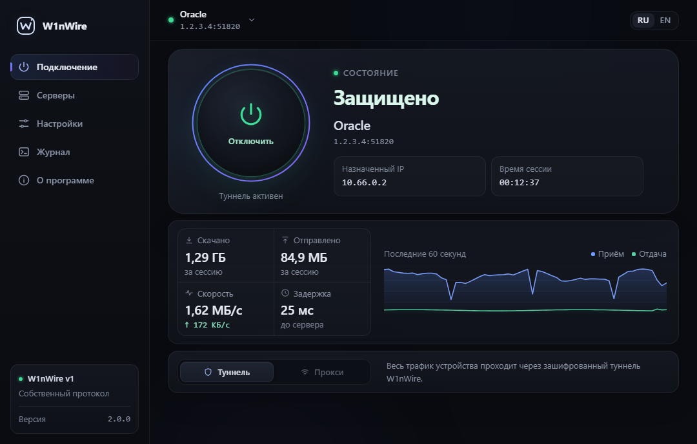
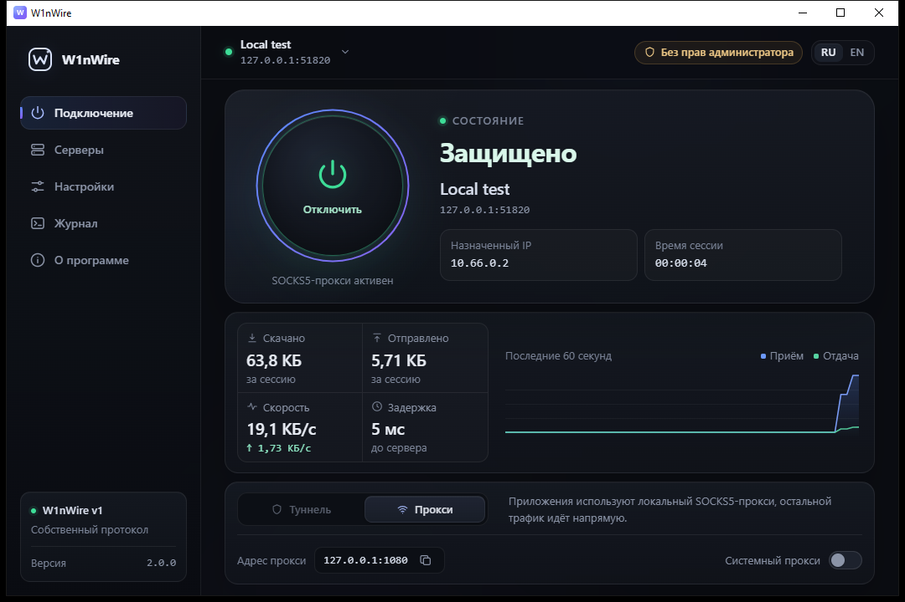

# W1nWire

A self-hosted VPN with its own cryptographic protocol, a Windows desktop app and
a free server. Written in Go, MIT licensed. No subscription, no accounts, no
telemetry.

[](https://github.com/w1nchi/w1nwire/actions/workflows/ci.yml)
[](https://github.com/w1nchi/w1nwire/actions/workflows/release.yml)
[](LICENSE)
[](go.mod)



**W1nWire gives you the whole path, and you control all of it.** The protocol is
written from scratch in this repository. The Windows client has a proper GUI.
The Linux server fits into Oracle Cloud's Always Free tier, and one command
installs it. No part of the chain is somebody else's black box.

---

## What you get

| | |
|---|---|
| **Windows app** | `w1nwire-desktop.exe`: a single file with a dark UI, a live traffic graph, server profiles, invite codes and one-click connection |
| **Full tunnel mode** | All IPv4 traffic from the machine goes through the server via the Wintun driver (installed on demand, needs administrator rights) |
| **Proxy mode** | A local SOCKS5 listener, with an optional switch for the Windows system proxy. Works without administrator rights |
| **Free server** | A Linux binary and `install.sh`, which turn a fresh Ubuntu VM into a VPN server in about two minutes |
| **Free iPhone support** | The installer also sets up a WireGuard endpoint, so the free official WireGuard app from the App Store can connect |
| **Own protocol** | Noise IK style handshake, X25519, HKDF-SHA256, ChaCha20-Poly1305, replay window, stateless cookies |
| **Operations** | systemd, NAT, firewall, Prometheus metrics, Grafana dashboard, alert rules, CI, reproducible releases |

What it costs: **nothing** for the server (Oracle Cloud Always Free), **nothing**
for the client (you build it from this repository) and **nothing** for the phone
(the WireGuard app is free). Oracle asks for a bank card, but only to verify your
identity. Always Free resources are not charged.

---

## Quick start

### 1. The server (about 5 minutes, free)

Create an Ubuntu 24.04 VM. The cheapest sensible option is **Oracle Cloud Always
Free**, and [docs/ORACLE.md](docs/ORACLE.md) walks through the console steps.
Then, on the VM, run:

```bash
curl -fsSL https://raw.githubusercontent.com/w1nchi/w1nwire/main/deploy/install.sh | sudo bash
```

The installer downloads the right binary, generates the keys, installs the
systemd unit, turns on forwarding and NAT, opens the UDP port and prints
something like this:

```
============================================================
 W1nWire server is running
 Address: 203.0.113.7:51820
 Invite code (copy the whole line into the W1nWire app):
 ww1.eyJ2IjoxLCJuIjoiZGVza3RvcCIsImgiOiIyMDMuMC4xMTMuNzo1MTgyMCIs...
============================================================
```

The invite code is a **credential**. It holds the server's address, its public
key and the private key of one client, so treat it like a password.

Any other VPS running Ubuntu 22.04/24.04 or Debian 12 works too, because the
script does not depend on a particular provider. Before you expose anything to
the internet, read [deploy/README.md](deploy/README.md) and
[docs/SERVER.md](docs/SERVER.md).

### 2. The Windows client

Download `w1nwire-desktop.exe` from the
[releases page](https://github.com/w1nchi/w1nwire/releases), or build it yourself
(`make desktop`, see below). Run it, press **"Add server" → "Import code"**,
paste the invite code and press **Connect**.

* **Tunnel** mode asks for administrator rights once. It needs them to create a
  Wintun adapter and change the routing table. After that, everything goes
  through the server.
* **Proxy** mode needs no special rights. It starts a SOCKS5 listener on
  `127.0.0.1:1080` and can switch the Windows system proxy for you.

The status screen shows your tunnel address, uptime, throughput and a live
graph. The **Logs** tab shows exactly what the client is doing.

### 3. The iPhone (also free)

On the server, run the installer again with `--ios`. On an existing
installation, use `sudo ./install.sh --ios`. It sets up a WireGuard endpoint on
UDP 51821 and prints a QR code. Install the free **WireGuard** app from the App
Store, scan the code and turn the tunnel on. More in [docs/IOS.md](docs/IOS.md).

The iPhone uses WireGuard instead of the W1nWire protocol. A native iOS VPN
needs a Network Extension, and that requires a paid Apple Developer account. The
WireGuard client is free and does the same job, and your server speaks both
protocols.

---

## How it works

```
        Windows app                               Linux server
 ┌───────────────────────┐                ┌──────────────────────────┐
 │  interface (WebView2) │                │  w1nwire-server          │
 │  internal/ui + app    │                │  internal/server         │
 └───────────┬───────────┘                └────────────┬─────────────┘
             │ profiles, engine                         │
 ┌───────────▼───────────┐    encrypted UDP   ┌────────▼─────────────┐
 │  internal/client      │◄──────────────────►│  internal/protocol   │
 │  Wintun / SOCKS5      │   ChaCha20-Poly1305│  handshake, sessions │
 └───────────────────────┘                    └────────┬─────────────┘
                                                      │ TUN + NAT
                                                      ▼
                                                   internet
```

The client and the server speak a protocol that was designed and written in this
repository:

* **Handshake.** It follows the shape of Noise IK. A stateless cookie ties the
  handshake to the source address the packet came from. Then an ephemeral to
  static and a static to static X25519 exchange produce the session keys.
* **Keys.** HKDF-SHA256 with a separate label for every key. Each direction has
  its own key and counter, and keys are renewed every two minutes.
* **Data.** ChaCha20-Poly1305 with a 64-bit counter as the nonce, plus a sliding
  replay window of 64 packets.
* **Payloads.** Two kinds of traffic share the encrypted transport: raw IP
  packets (tunnel mode) and framed TCP streams (proxy mode). In proxy mode the
  client sends host names and the server resolves them, so DNS never leaks.

The details are in [docs/PROTOCOL.md](docs/PROTOCOL.md) and
[docs/ARCHITECTURE.md](docs/ARCHITECTURE.md). The security analysis is in
[docs/THREAT-MODEL.md](docs/THREAT-MODEL.md).

### Why not just use WireGuard?

Because the point of this project is to own the whole path: the handshake, the
key schedule, the framing, the client and the deployment. If you want a mature
tunnel today, use WireGuard. It is excellent. If you want to understand and
control every byte, this repository is for you. The iPhone path reuses WireGuard
on purpose, because an iOS VPN client is held back by a $99 a year fee, not by
engineering.

---

## Windows tunnel mode in detail

`internal/tun/tun_windows.go` drives the Wintun driver:

1. The app looks for `wintun.dll` next to the executable, then in
   `%LOCALAPPDATA%\W1nWire`, then in `System32`. If it is missing, the app
   downloads the official build from `wintun.net`, checks its SHA-256 and stores
   it in `%LOCALAPPDATA%\W1nWire`. The DLL is **not** shipped in this repository.
   Wintun is GPLv2, and keeping it out of the tree keeps the project's license
   clean.
2. A `W1nWire` adapter is created with a stable GUID, a session is opened and
   packets are read from the ring buffer through the wait event.
3. The address, the MTU and the DNS server are set through the IP Helper API,
   with `netsh` as a fallback.
4. Instead of replacing the default route, the app installs two half-default
   routes (`0.0.0.0/1` and `128.0.0.0/1`) on the tunnel interface. A separate
   `/32` route pins the VPN server to the physical gateway, so the encrypted UDP
   does not loop back into the tunnel. IPv6 is blocked while the tunnel is up,
   so applications fall back to IPv4 instead of leaking around the VPN.
5. On disconnect everything is removed. If the app crashes, the next start
   deletes the leftover routes.

By default the app runs without elevated rights. In tunnel mode it offers a
**"Restart as administrator"** button that relaunches it through UAC.

## Proxy mode in detail

`internal/socks5` serves CONNECT on `127.0.0.1:1080`. The destination host name
travels inside the tunnel (`FrameOpen`) and the server resolves it, so the client
never sends a DNS query.

The **"System proxy"** switch writes to `HKCU\...\Internet Settings`, and when
the tunnel goes down it restores the previous values, including a PAC script if
there was one. Browsers (Chrome, Edge, Internet Explorer) and applications that
honour WinINET pick it up right away. Firefox and Telegram have to be pointed at
`127.0.0.1:1080` by hand.

---

## Building from source

You need Go 1.26 or newer. For the icon you need nothing else, because the
resource generator is a Go tool too.

```bash
# Windows application (run from Windows)
pwsh -File scripts/build-windows.ps1 -Version 2.0.0

# or with GNU make on any platform
make desktop          # dist/w1nwire-desktop.exe, cross compiled
make dist             # the desktop app, Linux server binaries and the installer
make test             # unit tests
make test-race        # the same with the race detector
```

`scripts/build-windows.ps1` runs the tests, generates the icon, the manifest and
the version information with `go-winres`, builds the GUI executable, cross
compiles the Linux server for amd64 and arm64, and writes a zip together with
`SHA256SUMS.txt`.

---

## Project layout

```
cmd/w1nwire-desktop/    Windows app: WebView2 window, single instance, UAC
cmd/w1nwire-server/     server: run, keygen, peer add/list/remove
cmd/w1nwire-client/     command line client (proxy or tunnel mode on Linux)
internal/app/           profiles, settings, engine, self test, system proxy
internal/ui/            embedded single page interface and local JSON API
internal/client/        client state machine, tunnel and proxy modes
internal/server/        UDP server, peer routing, stream relay
internal/protocol/      handshake, session, messages, replay window
internal/crypto/        X25519, HKDF-SHA256, ChaCha20-Poly1305
internal/tunnel/        payload frames, client and server stream managers
internal/tun/           TUN devices: Linux, Wintun, loopback
internal/socks5/        the local SOCKS5 listener
internal/winproxy/      WinINET proxy settings, with exact restore
internal/winutil/       elevation, autostart, single instance
internal/invite/        the invite code format
deploy/                 installer, systemd units, cloud-init, Terraform
monitoring/             Prometheus, Grafana dashboard, alert rules
docs/                   protocol, architecture, threat model, guides
packaging/icon/         the icon generator and the generated icon
scripts/                build scripts
```

---

## Self test

The app can prove that it works without a VPN server and without a driver. Go to
**Settings → Check installation**. It starts a real W1nWire server on the
loopback interface and a real client, then makes an HTTP request through the
SOCKS5 listener. If the marker comes back, the handshake, the key schedule, the
encryption, the stream framing and the proxy all work.

`internal/integration/integration_test.go` covers the same path in CI.



The screenshot above is not a mock-up. It shows the released executable
connected to a W1nWire server on `127.0.0.1:51820`, with
`curl --socks5-hostname` fetching `example.com` through it. The 2 ms latency is
the real handshake round trip on loopback.

---

## Security notes

* The server terminates the tunnel, so whoever runs it can see where you connect
  and, in proxy mode, the plaintext of your connections. Run your own server.
* The invite code is a credential. If it leaks, rotate it with
  `w1nwire-server peer remove` followed by `peer add`.
* The protocol is not obfuscated. A DPI system that knows the header can
  recognise and block it. There is no traffic padding and no defence against
  timing analysis.
* The Windows app is not code signed, so SmartScreen will warn you on the first
  launch. The release includes `SHA256SUMS.txt` so you can verify the binary.
* The full list is in [docs/THREAT-MODEL.md](docs/THREAT-MODEL.md).

---

## Limitations

* Inside the tunnel it is IPv4 only. IPv6 is blocked, not tunnelled.
* The SOCKS5 proxy handles TCP only (`CONNECT`). UDP is refused.
* Tunnel mode exists only on Windows (Wintun) and Linux (TUN). macOS can use
  proxy mode.
* There is no iPhone app. The iPhone uses the WireGuard endpoint of the same
  server.
* There is no kill switch. If the client dies, the routes are removed and
  traffic goes out over the normal connection.
* The server sees plaintext, and the client trusts whichever server is set in its
  profile.

---

## License

MIT, see [LICENSE](LICENSE). The Wintun driver that the app downloads at runtime
is distributed by the WireGuard project under GPLv2 and is not part of this
repository. The WebView2 runtime is part of Microsoft Edge.

Russian version: [README.ru.md](README.ru.md).
