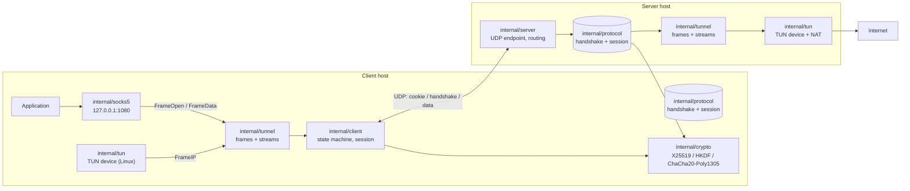

# W1nWire — Architecture

This document describes how W1nWire is put together: the components, the path a
packet takes from an application to the internet, the client state machine, the
stream lifecycle in proxy mode and the way the payload framing is extended.

The byte-level description of the wire format lives in
[`PROTOCOL.md`](PROTOCOL.md). The security properties and their limits are
analysed in [`THREAT-MODEL.md`](THREAT-MODEL.md).

---

## 1. What W1nWire is

W1nWire is a self-hosted VPN that speaks its own protocol instead of
delegating to WireGuard or OpenVPN. A server runs on a cheap always-free
instance (Oracle Cloud Always Free) and gives one or more clients egress with
the IP address of that instance.

The client has two operating modes:

| Mode | Transport in the tunnel | Privileges | Platforms |
| ---- | ---------------------- | ---------- | --------- |
| **tunnel** | raw IPv4 packets carried in `FrameIP` | root / `CAP_NET_ADMIN`, TUN device | Linux |
| **proxy**  | TCP streams carried in `FrameOpen` / `FrameData` | none | any OS, including phones |

Both modes share the same handshake, the same session keys and the same data
plane. They differ only in the payload that is carried inside the encrypted
`Data` packets.

---

## 2. Component map



The same diagram in ASCII, for readers who prefer plain text:

```
   application
       |
       |  (tunnel mode)              (proxy mode)
       v                             v
  TUN device  <--->  internal/tunnel  <--->  SOCKS5 listener
                            |                (127.0.0.1:1080)
                            v
                   internal/client  -->  internal/protocol
                                            |
                                       internal/crypto
                                            |
                          ========== encrypted UDP ==========
                                            |
                                       internal/server
                                       internal/protocol
                                       internal/tunnel
                                       internal/tun  --> internet
```

---

## 3. Packages and responsibilities

| Package | Responsibility | Does not do |
| ------- | -------------- | ----------- |
| `cmd/w1nwire-server` | Entry point: flags `-config`, `-log-level`; sub-commands `keygen`, `version`; metrics HTTP server | Any protocol logic |
| `cmd/w1nwire-client` | Entry point: flags `-config`, `-log-level`; sub-commands `gen-config`, `keygen`, `version` | Any protocol logic |
| `internal/crypto` | X25519 key pairs and DH, local HKDF-SHA256, ChaCha20-Poly1305 AEAD, constant-time comparison, MAC helper | Session or message semantics |
| `internal/protocol` | Message encoding/decoding, Noise-IK-style handshake (initiator and responder), session keys, sliding replay window | Payload framing, I/O |
| `internal/tunnel` | Payload framing inside the encrypted channel (`FrameIP`, `FrameOpen`, `FrameOpenAck`, `FrameData`, `FrameClose`) and the stream managers of both sides | Encryption, sockets |
| `internal/socks5` | Minimal local SOCKS5 server: negotiation, `CONNECT`, address parsing | Opening remote connections (delegated to the stream manager) |
| `internal/tun` | TUN device creation (Linux), interface configuration, route installation, NAT masquerading | Cryptography |
| `internal/server` | UDP endpoint, handshake dispatch, session table, peer lookup by tunnel IP, relay of IP packets and streams | Key derivation |
| `internal/client` | UDP endpoint, handshake state machine, TUN mode, SOCKS5 mode, keepalive and rekey timers | Key derivation, framing |
| `internal/metrics` | The Prometheus metric contract shared by server and client | Scraping |
| `internal/config` | JSON configuration of server and client with strict validation (unknown fields are rejected) | Runtime state |
| `internal/integration` | End-to-end test: real server + real client over loopback, HTTP request through the client SOCKS5 proxy | — |
| `deploy/` | Terraform for Oracle Cloud, cloud-init bootstrap, systemd units, helper scripts | Application code |
| `monitoring/` | Prometheus configuration, Grafana dashboard, alert rules | Application code |

---

## 4. Packet path

### 4.1 Tunnel mode

```
   OS routing table
        |
        v
   [ TUN device w1nwire0 ]            <-- read by internal/tun on the client
        |  raw IPv4 packet
        v
   internal/client.handleTunnelPacket
        |  prepend 0x01 (FrameIP)
        v
   internal/tunnel.EncodeIP frame
        |
        v
   internal/protocol.Session.Encrypt     <-- ChaCha20-Poly1305, counter nonce
        |  Data packet: 0x05 | recvIdx | sendIdx | counter | ciphertext
        v
   UDP socket  ------------------------------>  server
                                                  |
                                                  v
                                        internal/server.handleData
                                        Session.Decrypt (replay window)
                                                  |
                                                  v
                                        payload[0] == FrameIP
                                                  |
                                                  v
                                        internal/server.deliverToTunnel
                                                  |
                                                  v
                                        [ TUN device w1nwire0 ] on the server
                                                  |
                                          ip_forward + MASQUERADE
                                                  |
                                                  v
                                              internet
```

The reverse direction is symmetric. On the server the peer is identified by the
source address of the IP packet inside the tunnel, which is mapped back to the
session through the configured peer list (`tunnel_address` -> peer).

### 4.2 Proxy mode

```
   application (browser, curl, phone app)
        |  SOCKS5 CONNECT example.com:443
        v
   [ SOCKS5 listener 127.0.0.1:1080 ]     internal/socks5
        |  address as a NAME, not an IP
        v
   internal/tunnel.ClientStreams.Open
        |  FrameOpen{streamID, ProtoTCP, "example.com:443"}
        v
   internal/protocol.Session.Encrypt  --> UDP --> server
                                                    |
                                                    v
                                          internal/tunnel.ServerStreams.handleOpen
                                                    |  net.Dial("tcp", "example.com:443")
                                                    |  DNS resolution happens here
                                                    v
                                          FrameOpenAck{status}
                                                    |
                                                    v
        FrameData <-------------------------------> FrameData   (bidirectional relay)
        FrameClose <------------------------------> FrameClose
```

Two properties follow directly from this picture:

* the server performs the DNS resolution, so the client never issues a DNS
  query for the destination — the hostname travels inside the encrypted
  tunnel and the resolver only sees the server's queries;
* the destination socket is opened by the server, therefore the target sees
  the server's IP address, not the client's.

---

## 5. Message dispatch

Transport level (UDP datagrams, first byte selects the type):

| Message | Type | Receiver | Handler | What it does |
| ------- | ---- | -------- | ------- | ------------ |
| `CookieRequest`    | `0x01` | server | `server.handleCookieRequest` -> `Responder.HandleCookieRequest` | Verifies `mac1`, issues a stateless cookie bound to the observed source address and a 120 s expiry |
| `CookieResponse`   | `0x02` | client | `client.handleCookieResponse` -> `Initiator.ApplyCookieResponse` | Stores the cookie, generates the ephemeral X25519 pair, moves the state to `init` |
| `HandshakeInit`    | `0x03` | server | `server.handleHandshakeInit` -> `Responder.HandleHandshakeInit` | Verifies the cookie, finds the peer by trial decryption, derives `k2` and the data keys, creates the session |
| `HandshakeResp`    | `0x04` | client | `client.handleHandshakeResponse` -> `Initiator.ApplyHandshakeResponse` | Authenticates the server via `k2`, checks the server clock, derives the data keys, moves the state to `ready` |
| `Data`             | `0x05` | both   | `handleData` -> `Session.Decrypt` | Replay-window check, AEAD open, then dispatch by the inner frame type |
| `Keepalive`        | `0x06` | both   | `handleKeepalive` -> `Session.DecryptKeepalive` | Keeps the NAT mapping alive and proves liveness |

Payload level (inside a decrypted `Data` packet, first byte selects the type):

| Frame | Type | Produced by | Consumed by | What it does |
| ----- | ---- | ----------- | ----------- | ------------ |
| `FrameIP`      | `0x01` | whichever side owns the tunnel | the other side | Carries one raw IPv4 packet |
| `FrameOpen`    | `0x02` | client | server | Requests a stream to `host:port` |
| `FrameOpenAck` | `0x03` | server | client | Confirms (`0x00`) or refuses (`0x01`, `0x02`) the stream |
| `FrameData`    | `0x04` | both | the other side | Carries stream bytes |
| `FrameClose`   | `0x05` | both | the other side | Tears the stream down |

The frame type byte is protected by the AEAD, so a peer cannot inject a frame
of another family, and the two families never interfere: the client routes
`0x01` to the TUN device and everything else to the stream manager, the server
does the mirror image.

---

## 6. Client state machine

```
                 startHandshake()
   +-------+   (cookie request)   +---------+   (cookie response)  +-------+
   | idle  | --------------------> | cookie  | -------------------> | init  |
   +-------+                       +---------+                      +-------+
       ^                                |                               |
       |  handshake timed out (10 s)   |  handshake timed out (10 s)   |
       |                                v                               |
       |          resetHandshake()  +-------+                           |
       +--------------------------- | idle  | <-----------------------+
                                   +-------+        failed authentication
                                                                     |
                                                                     v
                                                                  +-------+
                                                                  | ready |
                                                                  +-------+
```

| State | Meaning | Timeout | On timeout / failure |
| ----- | ------- | ------- | -------------------- |
| `idle` | No session. The client sends a `CookieRequest`. | — | — |
| `cookie` | Waiting for the `CookieResponse`. | 10 s | Reset to `idle`, the handshake is retried |
| `init` | Waiting for the `HandshakeResp`. The ephemeral key pair already exists. | 10 s | Reset to `idle`, the handshake is retried |
| `ready` | A session exists, data plane is active. | — | — |

Details:

* the transition out of `idle` is driven by a one-second supervisor tick, so a
  failed handshake is retried shortly after the timeout (the `retryInterval`
  constant in `internal/client/client.go` documents the intended 5 s pause);
* `startHandshake` is ignored while the client is in `cookie` or `init`, so a
  rekey timer tick cannot interrupt a handshake in flight;
* a successful `HandshakeResp` closes the previous session before installing
  the new one, which is what makes rekeying seamless for the data plane;
* the client refuses a `HandshakeResp` whose embedded server timestamp differs
  from the local clock by more than five minutes. This is a liveness check
  against a stale or spoofed response, not a precision time protocol.

Timers:

| Timer | Interval | Effect |
| ----- | -------- | ------ |
| Keepalive | 15 s | Sends an encrypted empty `Keepalive` packet |
| Rekey | 2 min | Starts a new handshake, producing a fresh ephemeral key pair |
| Supervisor | 1 s | Checks the handshake deadline and restarts from `idle` |

---

## 7. Streams in proxy mode

A stream is one TCP connection that the server opens on behalf of the client.

1. The SOCKS5 listener parses the `CONNECT` request. The address is kept as a
   **name** when the client supplied a domain name.
2. `ClientStreams.Open` allocates a monotonically increasing stream id and
   sends `FrameOpen`.
3. The client waits for `FrameOpenAck` for at most the dial timeout (15 s).
   `0x00` continues, anything else fails the SOCKS5 request.
4. The server dials the destination (`net.DialTimeout`, 15 s) and answers with
   `FrameOpenAck`. A refused protocol (anything but `ProtoTCP`) is rejected
   with `StatusRefused`.
5. From this point on both sides run a pump goroutine that copies bytes
   between the socket and the tunnel. The buffers are 32 KiB.
6. Either side closes the stream by sending `FrameClose`; both sides then
   remove the stream from their map and close the socket exactly once
   (`sync.Once`).

The stream id space is per session, so the ids of two clients never collide.
The server keeps one `ServerStreams` manager per peer, which means that a
failure of one stream cannot affect the streams of another client.

Note the asymmetry: the server is the active party on the outbound side. The
client never sees an address that is not already resolved by the server.

---

## 8. Rekeying and session lifetime

| Event | Behaviour |
| ----- | --------- |
| Client rekey timer (2 min) | The client starts a new handshake with a new ephemeral X25519 pair |
| Server receives a new `HandshakeInit` for a known peer | The old session is closed and removed from the session table, the new one replaces it |
| Session idle for 3 min on the server | The session is expired and the peer address is dropped |
| Keepalive (15 s, both sides) | Refreshes the NAT mapping and the `lastSeen` timestamp |

Because a rekey produces new ephemeral keys, the data keys change as well:
what was captured before the rekey cannot be decrypted with the keys that
follow it. This is what gives the protocol forward secrecy over time.

A rekey does not interrupt the streams of the proxy mode: the streams live in
`internal/tunnel`, which is independent of the session object. The new
session is installed before the old one is closed.

---

## 9. Extending the payload framing

The frame layer is deliberately small so that it can grow.

Rules for a new frame:

1. allocate a new byte in the frame type namespace (`0x01`..`0x05` are taken);
2. add `EncodeX` / `DecodeX` helpers in `internal/tunnel/frames.go`, following
   the existing pattern: a one-byte type, then the fields;
3. handle it in `ClientStreams.Handle` and `ServerStreams.Handle`. Both
   managers reject a frame that is not valid for their direction, which is how
   `FrameOpen` is kept on the client-to-server path and `FrameOpenAck` on the
   server-to-client path;
4. for the IP family, add a new branch next to the `FrameIP` check in
   `client.handleData` and `server.handleData`.

Compatibility is preserved by construction: frames travel inside the AEAD
protected `Data` payload, so a peer that does not know a frame type simply
fails to parse it and drops the payload. There is no negotiation step, and no
change to the handshake is needed for a new frame.

The frame type is the only structural element shared between the two payload
families. Everything else — the header layout of each frame, the stream
semantics — is independent.

---

## 10. Observability

The server exposes Prometheus metrics on `:9187/metrics`, the client on
`:9188/metrics` (both configurable, and both bound to `127.0.0.1` by default).
The metric names are a contract shared with `monitoring/`:

`w1nwire_up`, `w1nwire_handshakes_total{result}`,
`w1nwire_handshake_duration_seconds`, `w1nwire_sessions_active`,
`w1nwire_peers_total{state}`, `w1nwire_last_handshake_seconds{peer}`,
`w1nwire_bytes_total{direction}`, `w1nwire_packets_total{direction,kind}`,
`w1nwire_replay_dropped_total`, `w1nwire_decrypt_errors_total`,
`w1nwire_client_connected{peer}`.

Both binaries also expose `/healthz` next to `/metrics`.
